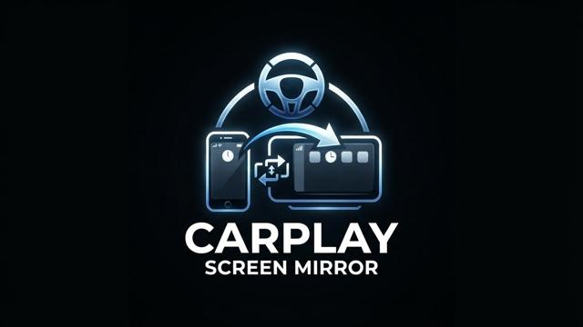

# Carplay Screen Mirror for Euro Truck Simulator 2 (v1.4.0)

Bu eklenti, ETS 2 araçlarına herhangi bir masaüstü uygulamasını (Spotify, YouTube, Tarayıcı, Discord vb.) yansıtmanızı sağlayan modun çekirdek (DLL) dosyasıdır.

⚠️ **ÖNEMLİ BİLGİ:**
Modun çalışabilmesi için Steam Atölyesi'nden moda abone olmanız (veya `.scs` mod dosyasını `Belgelerim/Euro Truck Simulator 2/mod` klasörüne atıp Mod Yöneticisi'nde etkinleştirmeniz) gerekmektedir:

👉 **[Steam Atölyesi Sayfasına Gitmek ve Abone Olmak İçin Tıklayın](https://steamcommunity.com/sharedfiles/filedetails/?id=3773481550)**

## ✨ v1.4.0 Yenilikleri
- **ETS2 1.62+ Tam Uyumluluk:** Son oyun güncellemesiyle birlikte ekranların gelmeme sorunu tamamen düzeltildi.
- **Çökme ve Performans Düzeltmeleri:** Yüksek sistemlerde yaşanan oyun açılış çökmeleri ve FPS düşüşleri giderildi.
- **Sadeleştirilmiş Menü & Anında Pencere Geçişi:** Oyun içi menü sadeleştirildi; aktif ekranda pencere değiştirdiğinizde yeniden yüklemeye gerek kalmadan anında geçiş yapar.
- **Görüntü Yakınlaştırma (Zoom) & Hizalama:** 1.0x - 5.0x yakınlaştırma, X/Y konum kaydırma ve Stretch / Fit / Fill ekran sığdırma modları.

## 🛠️ Kurulum
1. Sağ taraftaki **Releases** bölümünden (veya doğrudan [buraya tıklayarak](https://github.com/tingoja/CarplayScreenMirror/releases/latest)) güncel `CarplayScreenMirror.dll` (veya `.zip`) dosyasını indirin.
2. `CarplayScreenMirror.dll` dosyasını kopyalayın.
3. Dosyayı oyunun kurulu olduğu dizindeki `bin/win_x64/plugins/` klasörüne atın:
   `C:\Program Files (x86)\Steam\steamapps\common\Euro Truck Simulator 2\bin\win_x64\plugins\`
4. Oyuna girin ve **CTRL + F8** tuşlarına basarak menüyü açın!

---

This is the core plugin (DLL) file required for the Carplay Screen Mirror mod in ETS 2. This mod allows you to project any desktop application directly onto your truck's digital screens.

👉 **[Click Here to go to the Steam Workshop Page & Subscribe](https://steamcommunity.com/sharedfiles/filedetails/?id=3773481550)**

## 🛠️ Installation
1. Go to the **Releases** section on the right (or [click here](https://github.com/tingoja/CarplayScreenMirror/releases/latest)) and download `CarplayScreenMirror.dll` (or the release `.zip`).
2. Place `CarplayScreenMirror.dll` into your game's plugins directory:
   `Steam/steamapps/common/Euro Truck Simulator 2/bin/win_x64/plugins/`
3. Launch the game, press **CTRL + F8**, and enjoy!
